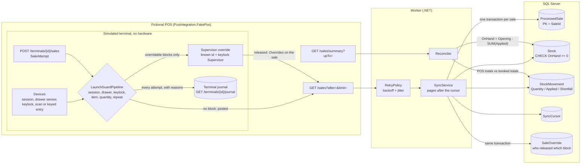

# dotnet-pos-integration

[](https://github.com/dc-tech-inc/dotnet-pos-integration/actions/workflows/ci.yml)
[](LICENSE)

A point-of-sale to stock integration in C# / .NET 10 and SQL Server: a worker pulls sales from a POS, takes them out of inventory exactly once, survives a flaky POS, and proves at the end that both sides agree. Operator tooling is PowerShell with Pester tests. One `docker compose up` runs the whole thing.

Built and maintained by DCtech. as an engineering reference. The POS is **fictional** (`PosIntegration.FakePos`), every SKU and sale is generated, and nothing here is derived from a real POS product, a client or an employer's system.

## The problem

A POS reports sales; a back-office database owns stock. The link between them is where stock goes wrong:

- the POS delivers at least once, so the same sale can arrive twice;
- the POS fails (503, timeouts) in the middle of a page;
- a sale can ask for more than the shelf holds, or for an item the stock system has never heard of;
- weeks later nobody can say whether the two systems still agree;
- an operator rings up a wrong sale (the same basket twice, a typed code, 100 instead of 10), and once the POS has committed it no back-office check can undo it.

This repository shows one way to handle each of those, with a test for every claim.

## Run it

```sh
cp .env.example .env
docker compose up --build
```

That starts SQL Server 2022, the fake POS (answering 503 to every 7th request and repeating the last 3 sales on each page), and the worker. The worker creates the database, loads 100 units of each of 10 SKUs, syncs 200 sales and reconciles. Expect a log like:

```text
Seeded 10 demo SKUs with 100 units each
Sync: 200 applied, 12 duplicate, 0 rejected, 26 unit(s) short
Reconciliation clean
```

(The same numbers appear in the CI `compose-smoke` job, which fails unless the worker exits 0.) With `WORKER_RUN_ONCE=true` the worker exits after one pass: `0` = clean, `2` = reconciliation found differences.

Without Docker, with any SQL Server you can reach and the .NET 10 SDK:

```sh
export POS_TEST_SQL="Server=localhost,1433;User Id=sa;Password=<yours>;TrustServerCertificate=True"
dotnet test                                    # integration tests run when POS_TEST_SQL is set, else they are skipped

export Worker__SqlConnection="Server=localhost,1433;Database=pos;User Id=sa;Password=<yours>;TrustServerCertificate=True"
export Worker__EnsureDatabase=true Worker__SeedDemo=true Worker__RunOnce=true
dotnet run --project src/PosIntegration.FakePos &   # http://localhost:5080
dotnet run --project src/PosIntegration.Worker
```

## Architecture

A sale starts at a terminal of the fictional POS. The terminal reads its simulated devices (cash session, drawer sensor, keylock, scanner or keyboard entry) and runs the launch guards before the sale exists. A blocked attempt stays in the terminal journal and never reaches the feed. A block that a supervisor may release needs a configured supervisor id and the keylock in the Supervisor position; the released codes travel with the sale. From there every sale takes the same path: the worker pulls the feed, books each sale once (idempotency by sale id), writes stock, movements and any overrides in one SQL Server transaction, and reconciles against the POS totals.



| Project | What it is |
|---|---|
| `src/PosIntegration.Core` | Domain and logic with no I/O: `SyncService`, `RetryPolicy`, `Reconciler`, `SaleValidator`, `LaunchGuardPipeline` with its `ISaleGuard`s, and the two ports `ISaleSource` / `IStockStore` |
| `src/PosIntegration.Data` | `SqlStockStore` (Dapper + SqlClient), the idempotent `schema.sql`, `SchemaMigrator` |
| `src/PosIntegration.Worker` | The host: HTTP source, retry classification, polling loop, options from environment |
| `src/PosIntegration.FakePos` | The fictional POS: deterministic sales, injectable 503s and redelivery, and simulated terminals that run the launch guards |
| `scripts/` | PowerShell module `PosTools` plus `Import-Stock.ps1`, `Export-Stock.ps1`, `Test-Health.ps1` |
| `tests/` | xUnit: unit tests, SQL Server integration tests, an end-to-end test; Pester tests live in `scripts/tests` |

## Rules the code enforces (and the tests check)

- **A sale is booked once.** The sale id is the primary key of `ProcessedSale`, inserted first in the same transaction as the stock change. Ten concurrent deliveries of one sale produce one `Applied` and nine `Duplicate`. ([ADR 1](docs/adr/0001-idempotency-in-the-database.md))
- **Stock never goes negative.** A line books `min(OnHand, quantity)`; the rest, or an unknown SKU, is recorded as `Shortfall` and logged. Twenty concurrent sales against 5 units of each of two SKUs, in opposite line orders, finish without a deadlock and with exactly 10 units taken. ([ADR 2](docs/adr/0002-shortfall-instead-of-negative-stock.md))
- **Transient failures are retried, permanent ones are not.** Exponential backoff with jitter; 5xx/408/429, SQL deadlocks and timeouts retry, 4xx does not. ([ADR 4](docs/adr/0004-pull-with-a-cursor-and-retry.md))
- **Both sides are compared.** Reconciliation asks the POS for per-SKU totals up to the highest booked sequence and compares them with the movements, then checks `Opening - OnHand = SUM(Applied)` per SKU. A rejected (invalid) sale shows up as a mismatch; stock edited behind the ledger shows up as drift.
- **The cursor never moves backwards**, even if two workers race, and a redelivered page does not move it at all.
- **A wrong sale is stopped before it exists.** Launch guards at the terminal block an open drawer, a missing session, a locked keylock, unknown or typed codes, unconfirmed or oversized quantities and a repeated basket. A supervisor override is stored with the sale in `dbo.SaleOverride`. ([ADR 6](docs/adr/0006-launch-guards-at-the-terminal.md))

## Launch guards (interlocks)

The terminal, its devices and the supervisor key are simulated through the fake POS API; nothing here reads real hardware. Defaults are in `src/PosIntegration.FakePos/appsettings.json` under `LaunchGuards:Default`, and `LaunchGuards:Terminals:{id}` changes them for one terminal (`T-02` requires the scanner). Any key can also be set from the environment, for example `LaunchGuards__Default__RequireScan=true` (see `.env.example`).

| Guard | What it stops | Setting | Limitation |
|---|---|---|---|
| `session` | A sale with no open cash session, or by an operator other than the one who opened it | `RequireOpenSession` | Session state lives in memory in the fake |
| `drawer` | The next sale while the drawer is open; a posted sale kicks the drawer open | `RequireDrawerClosed` | The drawer sensor is an API call (`PUT /terminals/{id}/drawer`) |
| `keylock` | Any sale with the keylock Locked; with `Supervisor`, any sale without the supervisor key | `RequiredKeylock`: `Normal` or `Supervisor` | The keylock is an API call (`PUT /terminals/{id}/keylock`) |
| `item` | A code that is not in the item file; a typed line when scanning is required (a supervisor can release the typed line) | `RequireKnownItem`, `RequireScan` | The item file is the fake's fixed catalogue |
| `quantity` | A line above the confirmation threshold that the operator did not confirm; a line above the limit, without a supervisor | `ConfirmQuantityAbove`, `SupervisorQuantityAbove` | The thresholds are configuration, not a standard |
| `repeat` | The same basket as the previous sale on that terminal inside the window (a supervisor can release it) | `RepeatWindowSeconds` | Compares with the previous sale only |

```sh
curl -X POST localhost:5080/terminals/T-01/session -H 'Content-Type: application/json' -d '{"operatorId":"OP-01"}'
curl -X POST localhost:5080/terminals/T-01/sales -H 'Content-Type: application/json' \
  -d '{"operatorId":"OP-01","lines":[{"sku":"SKU-0001","quantity":2}]}'   # 201, and the drawer is now open
curl -X POST localhost:5080/terminals/T-01/sales -H 'Content-Type: application/json' \
  -d '{"operatorId":"OP-01","lines":[{"sku":"SKU-0002","quantity":1}]}'   # 409 drawer-open
curl localhost:5080/terminals/T-01/journal
```

An override is the same request with `"supervisorId":"SUP-01"` after `PUT /terminals/{id}/keylock` with `{"position":"Supervisor"}`. It releases only the blocks marked as releasable above; an open drawer or an unknown code stays blocked.

## PowerShell tooling

```powershell
./scripts/Import-Stock.ps1 -Path ./scripts/sample-stock.csv -WhatIf     # validate and preview
./scripts/Import-Stock.ps1 -Path ./scripts/sample-stock.csv             # load opening stock
./scripts/Export-Stock.ps1 -Path ./stock-today.csv
./scripts/Test-Health.ps1 -PosApiUrl http://localhost:5080              # exit 0 healthy, 1 not
```

They need PowerShell 5.1+ or 7, the [SqlServer module](https://learn.microsoft.com/powershell/sql-server/download-sql-server-ps-module) (`Invoke-Sqlcmd`) and `POS_SQL_CONNECTION` (or `-ConnectionString`). Import validates the whole CSV first and reports every bad row in one error; re-importing a SKU keeps the sales already booked ([ADR 5](docs/adr/0005-powershell-tooling-with-a-mockable-sql-seam.md)).

## Tests and CI

CI (`.github/workflows/ci.yml`) runs on every pull request and every push to `main`:

| Job | What it checks |
|---|---|
| `dotnet` | `dotnet format --verify-no-changes`, build with warnings as errors, all tests with coverage against a `mcr.microsoft.com/mssql/server:2022-latest` service container; **fails if any test was skipped**; publishes both apps |
| `powershell` | PSScriptAnalyzer (warnings fail) and Pester 5.7.1 |
| `compose-smoke` | `docker compose up --build --exit-code-from worker`: the worker must reconcile clean against the flaky fake POS |
| `gitleaks` | Secret scan over the full history |

CodeQL (`codeql.yml`) is configured for C# and Actions; it runs once the repository is public (it is skipped while the repository is private on a Free plan).

Measured by CI on the pull request (run 39847175924): **56 xUnit tests passed, 0 skipped** (42 without a database, 14 against SQL Server 2022, including the concurrency and end-to-end tests; 18 of the 42 cover the launch guards and the simulated terminal, 2 of the 14 the stored overrides) and **13 Pester tests passed**. The compose smoke job logged `Sync: 200 applied, 12 duplicate, 0 rejected, 26 unit(s) short` and `Reconciliation clean`.

## Decisions

[ADR 1 idempotency in the database](docs/adr/0001-idempotency-in-the-database.md) · [2 shortfall instead of negative stock](docs/adr/0002-shortfall-instead-of-negative-stock.md) · [3 Dapper and plain SQL](docs/adr/0003-dapper-and-plain-sql.md) · [4 cursor and retry](docs/adr/0004-pull-with-a-cursor-and-retry.md) · [5 PowerShell with a mockable SQL seam](docs/adr/0005-powershell-tooling-with-a-mockable-sql-seam.md) · [6 launch guards at the terminal](docs/adr/0006-launch-guards-at-the-terminal.md)

## Limitations

- **Sales only.** There are no returns, voids, receipts or transfers, so `Opening` can only be changed by import. A real integration needs those events.
- **One store, one worker.** `STORE-01` is hard-coded in the fake; the cursor is global. Several workers would be safe for correctness (idempotency, `UPDLOCK`) but would duplicate reads.
- **Single-threaded booking.** One sale per transaction, in sequence order. Throughput is bounded by one round trip per sale.
- **No migration history.** `schema.sql` is idempotent but cannot alter an existing table. (Roadmap issue.)
- **Demo security.** The fake POS is unauthenticated and the compose stack uses the `sa` login with a self-signed certificate. Do not copy that.
- **PowerShell is not tested against a live database**; the SQL it generates is the same `MERGE` the C# integration test covers, and the wrapper function is mocked in Pester.
- **No metrics or tracing.** Logs only.
- **Simulated devices only.** Drawer, keylock, scanner and cash session are API calls on the fake POS, not OPOS, JavaPOS or Windows.Devices.PointOfService drivers. The terminal journal is in memory and lost on restart; only overrides reach SQL Server, not blocked attempts.
- **Tested against SQL Server 2022 in CI.** Other versions are untested.

## Roadmap

See the open issues: schema migrations with a versioned history, returns and voids, and metrics/health endpoint for the worker.

## Português (resumo)

Integração PDV → estoque em C#/.NET 10 e SQL Server pela DCtech.: um worker lê vendas de um PDV **fictício**, baixa o estoque uma única vez (a chave primária do id da venda garante a idempotência na mesma transação), nunca deixa o saldo negativo (a diferença vira *shortfall* registrado), repete falhas transitórias com backoff e, no fim, reconcilia os totais do PDV com o que foi lançado. Scripts PowerShell (importar/exportar estoque e health check) têm testes Pester. Travas de lançamento nos terminais simulados do PDV bloqueiam a venda antes de ela existir (gaveta aberta, caixa sem sessão, chave em Locked, código desconhecido ou digitado, quantidade sem confirmação ou acima do limite, mesma cesta repetida); o override de supervisor exige a chave na posição Supervisor e fica registrado em `dbo.SaleOverride`. Os dispositivos são simulados, sem hardware. Tudo é dado sintético; `docker compose up` sobe o conjunto.

## Sources

Launch guards (ADR 6): [OMG UnifiedPOS](https://www.omg.org/spec/UPOS/), [POS for .NET `Keylock`](https://learn.microsoft.com/previous-versions/windows/embedded/ms884534(v=winembedded.1002)), [Windows.Devices.PointOfService `CashDrawer`](https://learn.microsoft.com/uwp/api/windows.devices.pointofservice.cashdrawer) and [`BarcodeScanner`](https://learn.microsoft.com/uwp/api/windows.devices.pointofservice.barcodescanner), [Oracle Simphony cash drawer options](https://docs.oracle.com/en/industries/food-beverage/simphony/simcg/t_peripherals_cash_drawer.htm).

Design choices follow the official documentation: [.NET support policy](https://dotnet.microsoft.com/platform/support/policy) (.NET 10 is LTS), [SQL Server Linux container quickstart](https://learn.microsoft.com/sql/linux/quickstart-install-connect-docker) (`2022-latest` image, `MSSQL_SA_PASSWORD`, `mssql-tools18`), [Microsoft.Data.SqlClient](https://learn.microsoft.com/sql/connect/ado-net/microsoft-ado-net-sql-server), [Dapper](https://github.com/DapperLib/Dapper), [xUnit](https://xunit.net/docs/getting-started/v2/getting-started), [Pester](https://pester.dev/docs/quick-start) and [PSScriptAnalyzer](https://learn.microsoft.com/powershell/utility-modules/psscriptanalyzer/overview).

## License

MIT, Copyright (c) 2026 DC TECH INC.
